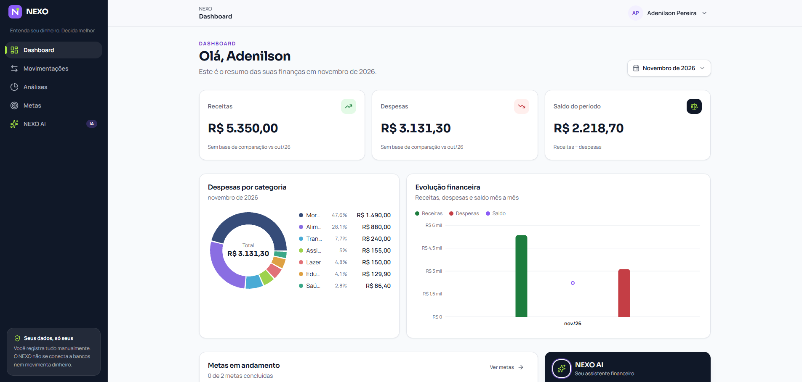
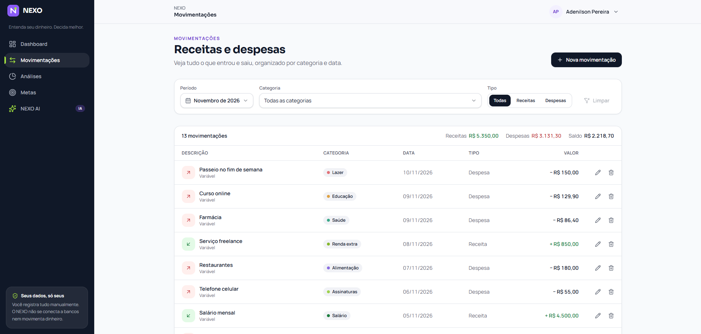
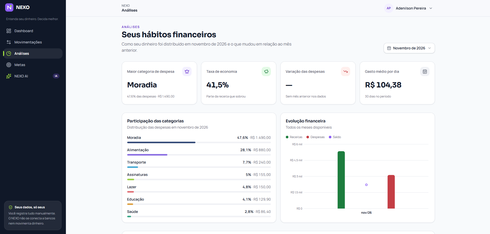
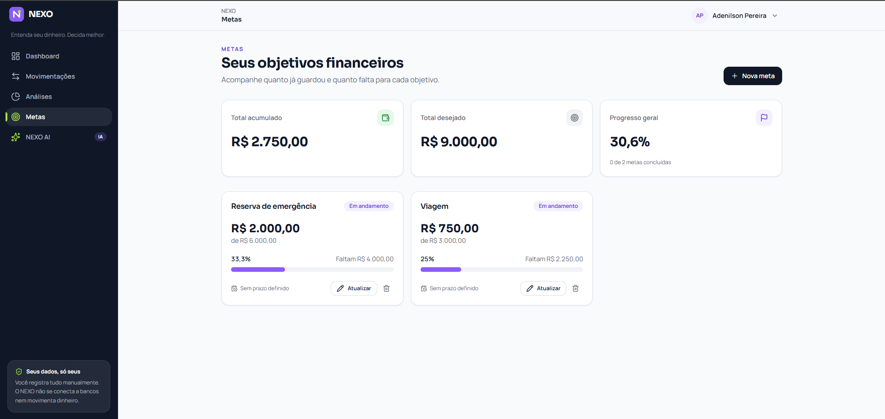
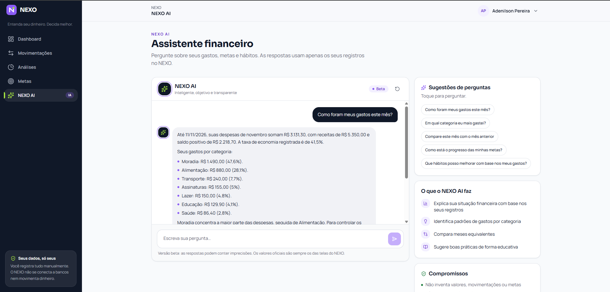
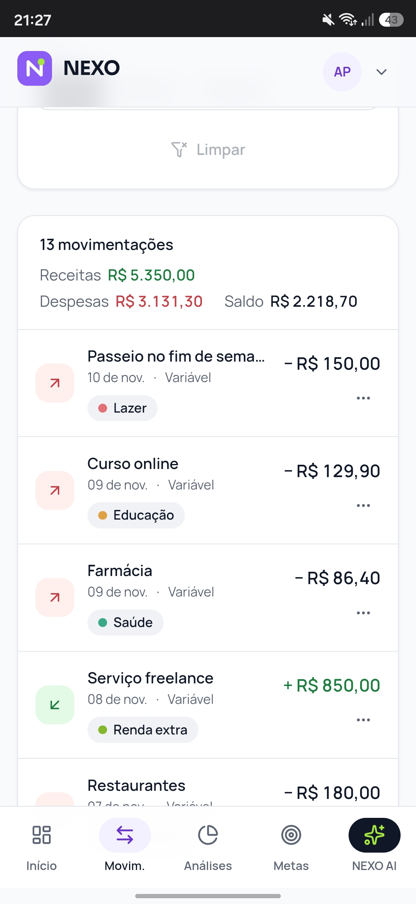

# NEXO — Assistente Inteligente de Finanças Pessoais

**Entenda seu dinheiro. Decida melhor.**

## Sobre o projeto

NEXO é uma aplicação web de gestão financeira pessoal com inteligência artificial integrada.

Seu propósito é transformar informações financeiras em análises compreensíveis, identificação de padrões e orientações educativas, ajudando o usuário a compreender melhor sua relação com o dinheiro.

Mais do que registrar receitas e despesas, o NEXO propõe uma experiência de organização financeira orientada por dados e inteligência artificial.

## Objetivos

- Oferecer uma experiência intuitiva de gestão financeira pessoal.
- Organizar receitas e despesas.
- Acompanhar metas financeiras.
- Identificar padrões de comportamento financeiro.
- Integrar um assistente inteligente à experiência.
- Aplicar engenharia de prompts e desenvolvimento com Vibe Coding.

## Funcionalidades

| Módulo | Descrição |
|---|---|
| Dashboard | Visão geral de receitas, despesas e saldo financeiro. |
| Movimentações | Cadastro, edição, exclusão e consulta de receitas e despesas. |
| Análises | Indicadores, comparativos e identificação de padrões financeiros. |
| Metas | Cadastro e acompanhamento de objetivos financeiros. |
| NEXO AI | Assistente inteligente para interpretação de dados e orientações educativas. |
| Autenticação | Cadastro e acesso de usuários com separação de dados financeiros. |

## Tecnologias e ferramentas

- **Lovable:** construção da aplicação utilizando Vibe Coding.
- **Inteligência Artificial:** apoio ao planejamento, geração e evolução da aplicação, além do assistente financeiro integrado.
- **Git e GitHub:** versionamento, organização e documentação do projeto.

## Metodologia

O desenvolvimento foi conduzido de maneira incremental, com foco em planejamento, engenharia de prompts e validação dos resultados.

1. Planejamento e definição da identidade do produto.
2. Elaboração da documentação e dos requisitos funcionais.
3. Definição da arquitetura conceitual e das regras de negócio.
4. Engenharia de prompts para orientar a construção da aplicação.
5. Desenvolvimento incremental utilizando Vibe Coding.
6. Avaliação dos resultados e refinamento das funcionalidades.
7. Validação funcional e registro das evidências.

## Estrutura do repositório

```text
nexo/
├── docs/
│   ├── 01-visao-do-produto.md
│   ├── 02-prd.md
│   ├── 03-especificacao-agente.md
│   ├── 04-ux-ui-e-navegacao.md
│   ├── 05-mvp-e-validacao.md
│   ├── 06-decisoes-do-projeto.md
│   ├── 07-relatorio-validacao-primeira-entrega.md
│   └── 08-relatorio-validacao-funcional.md
├── prompts/
│   ├── 01-prompt-mestre.md
│   ├── 02-prompt-estrutura-visual-e-navegacao.md
│   └── 03-prompt-evolucao-funcional.md
├── evidencias/
│   ├── 01-login.png
│   ├── 02-dashboard.png
│   ├── 03-movimentacoes.png
│   ├── 04-analises.png
│   ├── 05-metas.png
│   ├── 06-nexo-ai.png
│   └── 07-responsividade-mobile.png
├── README.md
└── .gitignore
```

## Evidências da aplicação

### Dashboard



### Movimentações



### Análises



### Metas



### NEXO AI



### Responsividade



## Escopo e limitações

O NEXO possui uma versão funcional com persistência de dados e recursos de inteligência artificial, mas ainda é caracterizado como um MVP.

Não contempla, nesta etapa:

- Integrações bancárias reais ou Open Finance.
- Operações financeiras ou movimentações bancárias.
- Recomendações personalizadas de investimentos.
- Garantia de precisão em análises financeiras complexas.

O assistente possui finalidade educativa e suas respostas devem ser interpretadas considerando os dados disponíveis e as limitações da inteligência artificial.

## Status do projeto

**Fase atual:** MVP funcional com validação dos principais fluxos concluída.

Os módulos principais foram testados, incluindo autenticação, movimentações, Dashboard, metas, isolamento entre usuários e consultas ao assistente NEXO AI.

A documentação registra as decisões, os prompts utilizados, os resultados obtidos e as evidências da evolução do produto.